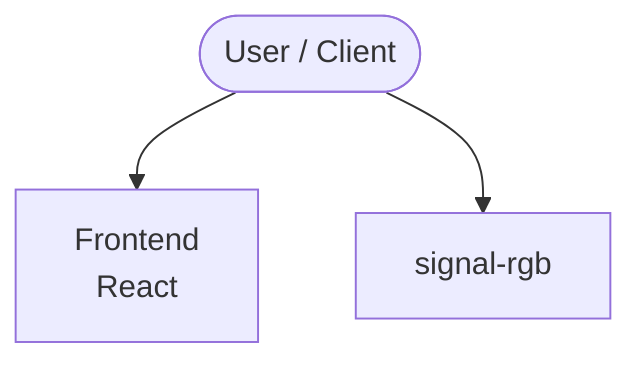

# signal-rgb — SignalRGB × Claude (MCP) tooling

Control [SignalRGB](https://signalrgb.com) from Claude Desktop, Claude Code, or any
[Model Context Protocol](https://modelcontextprotocol.io) client — plus a tiny CLI for
scripting it directly. "Set my RGB to a calm blue", "make the lights follow the screen",
"switch to an audio visualizer" — all natural-language, all local.

SignalRGB ships its own MCP server exposing ~60 tools: apply/install effects, tweak
effect properties live, per-LED overrides, device settings and layouts, and app/debug
logs. How you reach it depends on your SignalRGB version:

- **HTTP (current builds, verified on 2.5.86):** SignalRGB serves MCP directly over
  HTTP at `http://localhost:16037/mcp`. No separate binary, nothing to keep in sync
  across updates. **This is the recommended setup.**
- **stdio `SignalRgbMcp.exe` (older builds):** earlier versions shipped a standalone
  `SignalRgbMcp.exe` in a version-specific folder. The
  [`signalrgb-mcp.cmd`](signalrgb-mcp.cmd) wrapper in this repo keeps a config pointing
  at it from going stale across updates.

> ⚠️ On recent builds (confirmed on **2.5.86**) `SignalRgbMcp.exe` is no longer
> installed anywhere under `%LOCALAPPDATA%\VortxEngine`. A config that points at it
> launches nothing and the MCP client reports `CONNECTION_CLOSED`; use the HTTP
> transport below instead.

## The update problem the wrapper solves (legacy stdio path)

On builds that *do* ship it, SignalRGB installs `SignalRgbMcp.exe` into a
**version-specific** folder:

```
%LOCALAPPDATA%\VortxEngine\app-<version>\Signal-x64\SignalRgbMcp.exe
```

Point your MCP config at that path and it silently breaks on the next SignalRGB
auto-update. [`signalrgb-mcp.cmd`](signalrgb-mcp.cmd) resolves the newest installed
version at launch time, so your config never goes stale. (The HTTP transport avoids
this problem entirely; there is no path to go stale.)

## Setup

**Step 1: Enable MCP in SignalRGB** (required for either transport): Settings →
Application → AI Integration → toggle **Enable Model Context Protocol**, then
**restart SignalRGB** (the toggle does nothing until restart; the server answers
`"MCP is currently disabled"` otherwise).

### HTTP transport (recommended, current builds)

SignalRGB serves MCP at `http://localhost:16037/mcp` (its default MCP port, the port
SignalRGB's own config generator uses). Nothing to copy, no path to go stale.

**Claude Code**: add to `~/.claude.json` (`%USERPROFILE%\.claude.json`) under
`mcpServers`:

```json
"signalrgb": {
  "type": "http",
  "url": "http://localhost:16037/mcp"
}
```

…or, if the `claude` CLI is installed:

```powershell
claude mcp add --transport http --scope user signalrgb http://localhost:16037/mcp
```

**Claude Desktop**: add to `%APPDATA%\Claude\claude_desktop_config.json`:

```json
{
  "mcpServers": {
    "signalrgb": { "type": "http", "url": "http://localhost:16037/mcp" }
  }
}
```

SignalRGB can write both of these for you: **Settings → AI Integration → Claude Code /
Claude Desktop → Add to config**. Restart your MCP client afterwards.

### Legacy: stdio wrapper (older builds that ship `SignalRgbMcp.exe`)

Use this only on builds that still install `SignalRgbMcp.exe`. On builds without it
(e.g. 2.5.86) this path fails with `CONNECTION_CLOSED`; use HTTP above.

1. Copy `signalrgb-mcp.cmd` somewhere stable, e.g. `%USERPROFILE%\.claude\mcp\`.
2. Point your client at it:

```powershell
claude mcp add --scope user signalrgb -- cmd /c "%USERPROFILE%\.claude\mcp\signalrgb-mcp.cmd"
claude mcp list   # signalrgb: ... - √ Connected
```

Claude Desktop (`%APPDATA%\Claude\claude_desktop_config.json`):

```json
{
  "mcpServers": {
    "signalrgb": {
      "command": "cmd",
      "args": ["/c", "C:\\Users\\YOU\\.claude\\mcp\\signalrgb-mcp.cmd"]
    }
  }
}
```

Restart your client afterwards.

## CLI helper — `srgb.ps1`

Script SignalRGB without an MCP client (handshake + one tool call + exit).

> Note: `srgb.ps1` drives the **stdio** `SignalRgbMcp.exe` and so only works on builds
> that ship it. On HTTP-only builds (e.g. 2.5.86), call the endpoint directly instead,
> e.g. `Invoke-WebRequest http://localhost:16037/mcp -Method Post` with a JSON-RPC body.

```powershell
# What's running right now?
.\srgb.ps1 -Tool read_status

# Sync lights to whatever is on screen (movies, YouTube, games)
.\srgb.ps1 -Tool effect_apply -ArgsJson '{"name":"Screen Ambience"}'
.\srgb.ps1 -Tool effect_setproperties -ArgsJson '{"picture_mode":"Vivid","saturation":40}'

# Beat-reactive instead (reacts to system audio — Spotify, YouTube Music, anything)
.\srgb.ps1 -Tool effect_apply -ArgsJson '{"name":"Rave Visualizer"}'
```

## Tool highlights

| Tool | What it does |
| :--- | :--- |
| `read_status` / `read_effects` / `read_devices` | Current effect, effect library, connected devices |
| `effect_apply` / `effect_install` | Switch or install effects by name |
| `effect_setproperties` | Live-tweak the active effect (colors, sensitivity, modes) |
| `read_effectsettings` | Discover the active effect's tunable properties |
| `device_ledoverrides` | Pin individual LEDs to a color |
| `debug_*` | App, effect, plugin, and canvas logs |

## Notes

- Windows only (SignalRGB is Windows-only).
- Audio-reactive effects listen to the system's default audio output — no per-app wiring.
- SignalRGB also integrates with **NVIDIA G-Assist** (Settings → AI Integration) once
  G-Assist is installed via the NVIDIA App (RTX GPU with 6 GB+ VRAM required).

<!-- ARCH-DIAGRAM:START -->

## Architecture

> Auto-generated architecture diagram. See [`docs/context-map.md`](docs/context-map.md) for the full context map (core application, containers/cloud, and database connections).



<!-- ARCH-DIAGRAM:END -->
